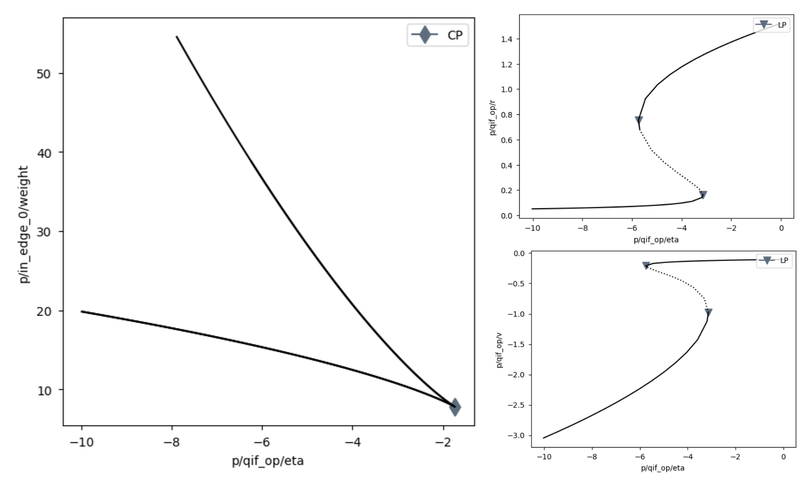

---
bibliography:
  - ../../references.bib
---
# AdEx Mean-Field
The AdEx mean-field model describes the population firing rates of a {term}`sparsely connected <Sparse connectivity>` network of excitatory and inhibitory adaptive exponential integrate-and-fire (AdEx) neurons (@brette2005) with {term}`conductance-based <Conductance-based synapse>` synapses. It builds on the master equation formalism of @elboustani2009, which describes population activity on a coarse-grained time scale $T$, chosen to be long enough that the network dynamics can be treated as Markovian, i.e. memoryless, at that resolution.

% REVIEW: state the assumptions on T precisely, as in El Boustani & Destexhe (2009).
Assuming the network is in an {term}`asynchronous irregular <Asynchronous irregular state>` regime, each
population's output firing rate can be written as a function of the statistical moments of its membrane potential fluctuations, which can be approximated as a function of its excitatory and inhibitory presynaptic input rates, via a fitted semi-analytic {term}`transfer function <Transfer function>` (@zerlaut2018). In @divolo2019, the model was extended to include an additional slow adaptation variable, which is included in the model's TVB implementation, `tvb.simulator.models.zerlaut.ZerlautAdaptationFirstOrder`, as well as its
second-order extension, `tvb.simulator.models.zerlaut.ZerlautAdaptationSecondOrder`.

## Model

In its first-order form, each node contains the excitatory and inhibitory population firing rates, $\nu_e$ and $\nu_i$ (`E` and `I`, in kHz), and an adaptation current $W_e$ for the excitatory population (`W_e`, in pA):

$$
\begin{aligned}
T\,\dot{\nu}_e &= \mathcal{F}_e(\nu_e, \nu_i, \nu_{\mathrm{ext}}, W_e) - \nu_e \\
T\,\dot{\nu}_i &= \mathcal{F}_i(\nu_e, \nu_i, \nu_{\mathrm{ext}}, W_i) - \nu_i \\
\dot{W}_e &= -\frac{W_e}{\tau_{w,e}} + b_e\,\nu_e + \frac{a_e\,(\mu_V - E_{L,e})}{\tau_{w,e}}
\end{aligned}
$$

where $T$ is the coarse-graining time scale, $\mathcal{F}_e$ and
$\mathcal{F}_i$ are the transfer functions of the two populations (see
below), and $\nu_{\mathrm{ext}}$ is the external excitatory input rate,
which combines long-range input from other regions, constant external drive
and noise (see [Network coupling](#network-coupling)). In the adaptation
equation, $\tau_{w,e}$ is the adaptation time constant, $b_e$ the
spike-triggered adaptation increment, $a_e$ the subthreshold adaptation
conductance, $E_{L,e}$ the leak reversal potential and $\mu_V$ the mean
membrane potential of the excitatory population.

An equivalent adaptation current $W_i$ can be defined for the inhibitory
population, but it is set to zero by default ($a_i = b_i = 0$), since
inhibitory neurons are typically modelled as fast-spiking cells without
adaptation.

The transfer function $\mathcal{F}$ gives the output firing rate from the
mean $\mu_V$, standard deviation $\sigma_V$ and autocorrelation time $\tau_V$
of the membrane potential fluctuations, which are computed from the presynaptic input rates:

$$
\mathcal{F} = \frac{1}{2\tau_V}\,
\operatorname{erfc}\!\left(\frac{V^{\mathrm{eff}}_{\mathrm{thr}} - \mu_V}{\sqrt{2}\,\sigma_V}\right)
$$

The effective threshold $V^{\mathrm{eff}}_{\mathrm{thr}}$ is a second-order fitted polynomial in $(\mu_V, \sigma_V,\tau_V)$, with ten coefficients per population (`P_e`, `P_i`). TVB's default coefficients are taken from the fit of @divolo2019.

The second-order model adds the covariances of the firing rates ($c_{ee}$, $c_{ei}$, $c_{ii}$) as state variables, which correct the rate equations for finite-size fluctuations [@elboustani2009; @divolo2019].

In the second-order model, the rate equations gain correction terms from
the covariances $c_{\lambda\eta}$ ($\lambda, \eta \in \{e, i\}$), which have
their own dynamics:

$$
\begin{aligned}
T\,\dot{\nu}_\mu &= \mathcal{F}_\mu - \nu_\mu
+ \frac{1}{2}\sum_{\lambda,\eta} c_{\lambda\eta}\,
\frac{\partial^2 \mathcal{F}_\mu}{\partial \nu_\lambda\,\partial \nu_\eta} \\[4pt]
T\,\dot{c}_{\lambda\eta} &= \delta_{\lambda\eta}\,
\frac{\mathcal{F}_\lambda\,(1/T - \mathcal{F}_\lambda)}{N_\lambda}
+ (\mathcal{F}_\lambda - \nu_\lambda)(\mathcal{F}_\eta - \nu_\eta)
+ \sum_{\mu} \left( c_{\lambda\mu}\,\frac{\partial \mathcal{F}_\eta}{\partial \nu_\mu}
+ c_{\eta\mu}\,\frac{\partial \mathcal{F}_\lambda}{\partial \nu_\mu} \right)
- 2\,c_{\lambda\eta}
\end{aligned}
$$

where $N_e = (1-g)\,N_{\mathrm{tot}}$ and $N_i = g\,N_{\mathrm{tot}}$ are the
population sizes. The first term is a finite-size noise term, which vanishes
for infinitely large populations. TVB computes the derivatives of
$\mathcal{F}$ numerically, by finite differences. The adaptation equations
are the same as in the first-order model.

### State variables

**First- and second-order models**

| name | description | unit |
|------|-------------|------|
| `E` | excitatory population firing rate, $\nu_e$ | kHz |
| `I` | inhibitory population firing rate, $\nu_i$ | kHz |
| `W_e` | excitatory adaptation current | pA |
| `W_i` | inhibitory adaptation current (off by default: `a_i = b_i = 0`) | pA |
| `ou_drift` | Ornstein–Uhlenbeck noise process added to the excitatory input | – |

**Second-order model only**

| name | description | unit |
|------|-------------|------|
| `C_ee` | variance of the excitatory firing rate, $c_{ee}$ | kHz² |
| `C_ei` | covariance of the excitatory and inhibitory firing rates, $c_{ei}$ | kHz² |
| `C_ii` | variance of the inhibitory firing rate, $c_{ii}$ | kHz² |

### Network coupling

Long-range input from other regions arrives through `E` only
(`cvar = [0]`). It is treated as an additional excitatory input rate to
each node's populations, together with a constant external drive
(`external_input_*`) and a noise term, `weight_noise × ou_drift`. Here
`ou_drift` is an Ornstein–Uhlenbeck process: it relaxes back to zero with
time constant `tau_OU`, while the stochastic integrator adds random
fluctuations to it, so the node receives temporally correlated noisy
excitatory input whose strength is set by `weight_noise`. With a
deterministic integrator, `ou_drift` stays at zero and there is no noise.

## Parameters

Note, ranges are the parameter domains declared in TVB's implementation. They
set slider limits and default exploration bounds, but are not enforced
when you set a value yourself.

| name | range | default | description |
|------|-------|---------|-------------|
| **Cellular properties** | | | |
| `g_L` | 0.1 – 100 | 10.0 | leak conductance (nS) |
| `E_L_e` | -90 – -60 | -65.0 | excitatory leak reversal potential (mV) |
| `E_L_i` | -90 – -60 | -65.0 | inhibitory leak reversal potential (mV) |
| `C_m` | 10 – 500 | 200.0 | membrane capacitance (pF) |
| **Adaptation** | | | |
| `a_e` | 0 – 20 | 4.0 | excitatory subthreshold adaptation conductance (nS) |
| `b_e` | 0 – 150 | 60.0 | excitatory spike-triggered adaptation increment (pA) |
| `tau_w_e` | 1 – 1000 | 500.0 | excitatory adaptation time constant (ms) |
| `a_i` | 0 – 20 | 0.0 | inhibitory subthreshold adaptation conductance (nS) |
| `b_i` | 0 – 100 | 0.0 | inhibitory spike-triggered adaptation increment (pA) |
| `tau_w_i` | 1 – 1000 | 1.0 | inhibitory adaptation time constant (ms) |
| **Synapses** | | | |
| `E_e` | -20 – 20 | 0.0 | excitatory reversal potential (mV) |
| `E_i` | -100 – -60 | -80.0 | inhibitory reversal potential (mV) |
| `Q_e` | 0 – 5 | 1.5 | excitatory quantal conductance (nS) |
| `Q_i` | 0 – 10 | 5.0 | inhibitory quantal conductance (nS) |
| `tau_e` | 1 – 10 | 5.0 | excitatory synaptic decay time (ms) |
| `tau_i` | 0.5 – 10 | 5.0 | inhibitory synaptic decay time (ms) |
| **Network** | | | |
| `N_tot` | 1000 – 50000 | 10000 | total number of neurons |
| `g` | 0.01 – 0.4 | 0.2 | fraction of inhibitory neurons |
| `p_connect_e` | 0.001 – 0.2 | 0.05 | connection probability from excitatory neurons |
| `p_connect_i` | 0.001 – 0.2 | 0.05 | connection probability from inhibitory neurons |
| `K_ext_e` | 0 – 10000 | 400 | number of external excitatory inputs per neuron |
| `K_ext_i` | 0 – 10000 | 0 | number of external inhibitory inputs per neuron |
| `T` | 1 – 20 | 20.0 | coarse-graining time scale (ms) |
| **Input and noise** | | | |
| `external_input_ex_ex` | 0 – 0.1 | 0.0 | external excitatory drive to the excitatory population (kHz) |
| `external_input_ex_in` | 0 – 0.1 | 0.0 | external inhibitory drive to the excitatory population (kHz) |
| `external_input_in_ex` | 0 – 0.1 | 0.0 | external excitatory drive to the inhibitory population (kHz) |
| `external_input_in_in` | 0 – 0.1 | 0.0 | external inhibitory drive to the inhibitory population (kHz) |
| `tau_OU` | 0.1 – 10 | 5.0 | time constant of the Ornstein–Uhlenbeck noise (ms) |
| `weight_noise` | 0 – 50 | 10.5 | strength of the noise input |
| `S_i` | 0 – 2 | 1.0 | scaling of long-range input to the inhibitory population (second-order only) |
| **Transfer function** | | | |
| `P_e`, `P_i` | – | see code | 10 fitted coefficients of the effective-threshold polynomial, per population |


## Dynamical regimes

```{phaseplane} montbrio_pazo_roxin
```


Based on the parameter settings, the model dynamics are organized around three fixed points (see the phase-plane above). Depending on the parameter settings, the model exhibits one of the three three regimes: low firing rate stable node (down state), high firing rate unstable focus (up state), and bistability (coexistence of up- and down-state). The regioins in the parameter space spanned by $\eta$ and $J$ are shown in the figure below together with the bifurcation diagrams of $r$ and $V$ wrt aprameter $\eta$. 



See [bifurcation](../../user-guide/sweep/bifurcation.md) page for more details on how to perform bifurcation analysis yourself.
