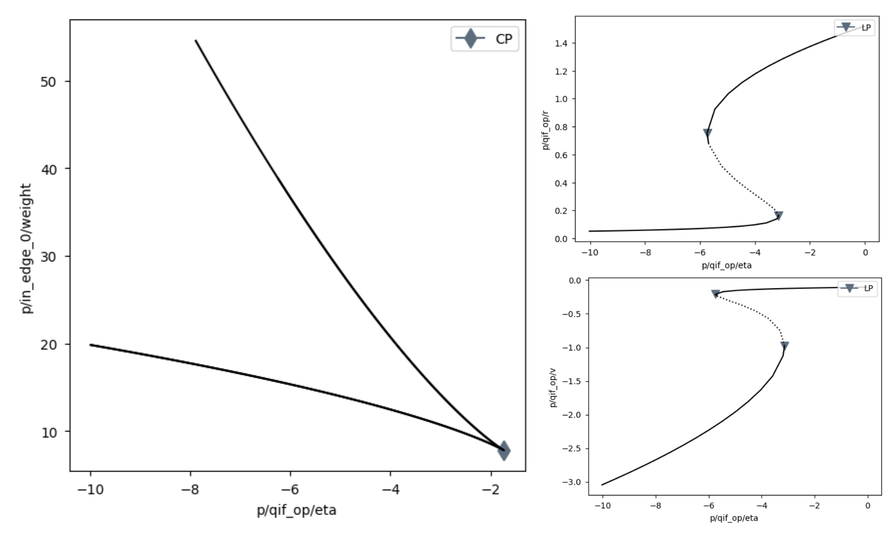

---
bibliography:
  - ../../references.bib
---
# Montbrió–Pazo–Roxin

The Montbrió–Pazo–Roxin [@montbrio2015] model is an exact macroscopic representation of an
infinite, all-to-all coupled population of quadratic integrate-and-fire (QIF)
neurons based on Ott-Antonsen reduction. Using mean firing rate and
mean membrane potential as macroscopic descriptive quantities, it reproduces
the dynamical states of the spiking population wrt external drive, including
synchronous firing patterns. This card documents the implementation in TVB
(`tvb.simulator.models.MontbrioPazoRoxin`).

## Model

The model is described by two state variables: $r$ (the population's average firing rate, constrained to
$r \ge 0$) and $V$ (its average membrane potential).

$$
\begin{aligned}
\dot{r} &= \frac{1}{\tau}\left(\frac{\Delta}{\pi\tau} + 2\,V\,r\right) \\[4pt]
\dot{V} &= \frac{1}{\tau}\Big(V^{2} - \pi^{2}\tau^{2} r^{2} + \eta + J\,\tau\,r + I + c_r\,C_r + c_v\,C_V\Big)
\end{aligned}
$$

Here $\eta$ is the center and $\Delta$ the half-width of the Lorentzian distribution
of intrinsic input currents across the population, $I$ is the constant external input,
$J$ scales the synaptic activation, and $tau$ sets the time scaling.

**Network coupling.** Both state variables can be coupled with $C_r$ and $C_V$ denoting the firing rate
and membrane potential coupling terms. Both enter the $\dot{V}$ weighted by `cr` and `cv` as an addive extension of the $I$, as does the external stimulus (`stvar = [1]`).

## Parameters

| name | range | default | description |
|------|-------|---------|-------------|
| `tau` | 0.001 – 15.0 | 1.0 | Characteristic time of the theta neurons; scales both equations |
| `I` | -10.0 – 10.0 | 0.0 | External (non-specific) current $I_{ext}$ |
| `Delta` | 0.0 – 10.0 | 1.0 | Half-width of the Lorentzian distribution of intrinsic currents |
| `J` | -25.0 – 25.0 | 15.0 | Mean recurrent synaptic weight (positive = excitatory) |
| `eta` | -10.0 – 10.0 | -5.0 | Mean of the Lorentzian distribution of intrinsic currents |
| `cr` | 0.0 – 1.0 | 1.0 | Weight of the external coupling that arrives through $r$ |
| `cv` | 0.0 – 1.0 | 0.0 | Weight of the external coupling that arrives through $V$ |


## Dynamical regimes

```{phaseplane} montbrio_pazo_roxin
```


Based on the parameter settings, the model dynamics are organized around three fixed points (see the phase-plane above). Depending on the parameter settings, the model exhibits one of the three three regimes: low firing rate stable node (down state), high firing rate unstable focus (up state), and bistability (coexistence of up- and down-state). The regioins in the parameter space spanned by $\eta$ and $J$ are shown in the figure below together with the bifurcation diagrams of $r$ and $V$ wrt aprameter $\eta$. 



See [bifurcation](../../user-guide/sweep/bifurcation.md) page for more details on how to perform bifurcation analysis yourself.
