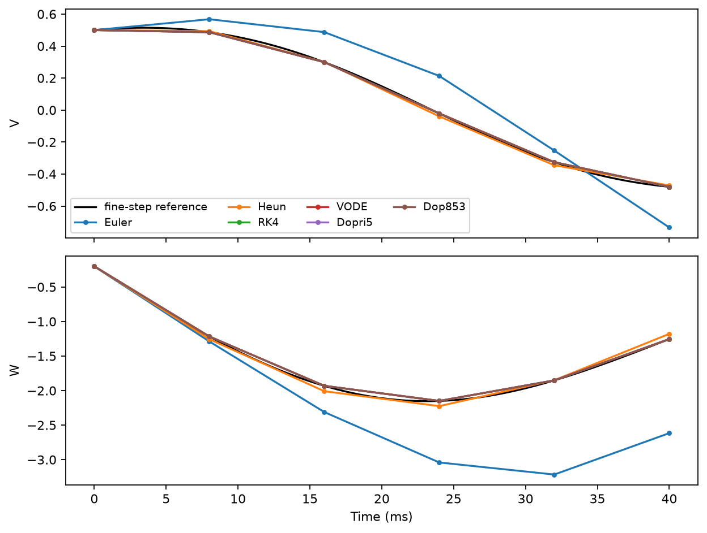
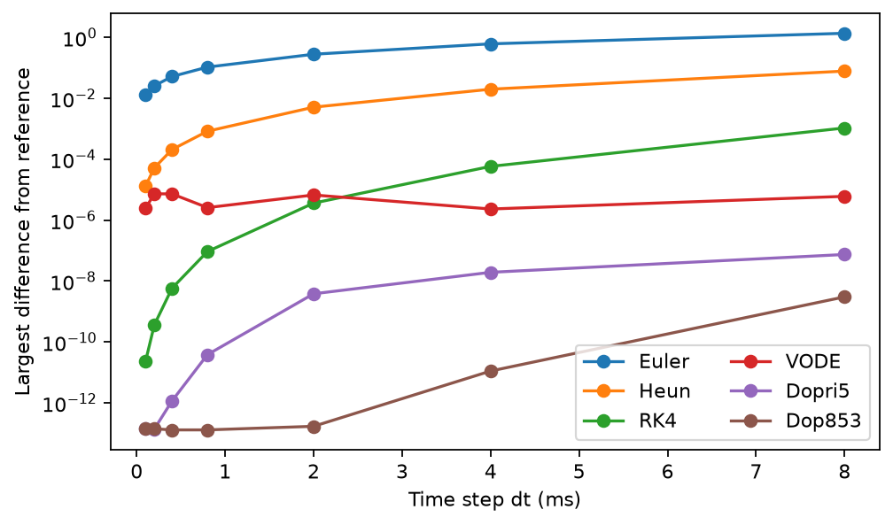
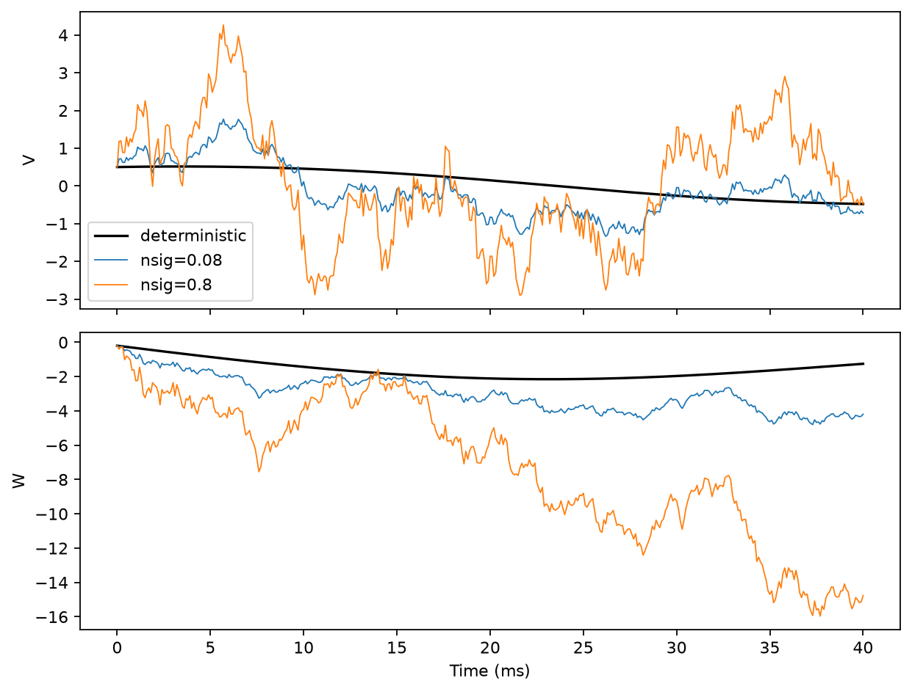
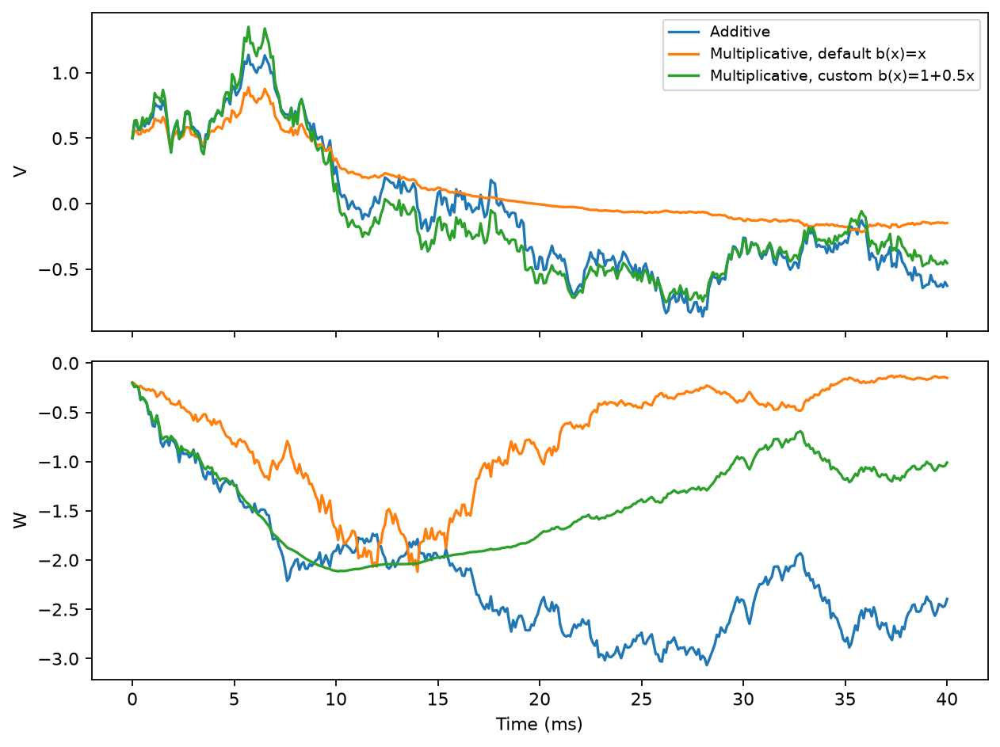

# Integrators

An {term}`integrator <Integrator>` solves the differential equations of a TVB
model at discrete times. Its {term}`time step <Time step>` `dt` is measured in
milliseconds. Together, the method and step size determine how accurately the
solution is approximated and how long the calculation takes.

TVB provides deterministic and stochastic integrators. The stochastic methods
use a noise object to generate increments during integration; its parameters
set the amplitude and temporal correlation of the forcing [@sanzleon2013].
In a network simulation, each step also updates the history of activity used
to evaluate delayed connections. Thus `dt` controls the resolution of both
the local dynamics and the long-range delays [@sanzleon2013; @sanzleon2015].

## Choosing an integrator and time step

The principal TVB integration classes are listed below. Their full parameters
are given in the [integrator API](https://docs.thevirtualbrain.org/api/tvb.simulator.integrators.html).

| Method | Deterministic class | Stochastic class | Description |
| --- | --- | --- | --- |
| Euler | `EulerDeterministic` | `EulerStochastic` | Simplest fixed-step update; the stochastic form is Euler–Maruyama. |
| Heun | `HeunDeterministic` | `HeunStochastic` | Fixed-step predictor–corrector update. |
| Fourth-order Runge–Kutta | `RungeKutta4thOrderDeterministic` | — | Four-stage, fourth-order deterministic update. |
| Identity | `Identity` | `IdentityStochastic` | Returns the next state supplied by the model. |
| VODE | `VODE` | `VODEStochastic` | Integration through SciPy's VODE solver. |
| Dormand–Prince 5 | `Dopri5` | `Dopri5Stochastic` | Integration through SciPy's fifth-order Dormand–Prince solver. |
| Dormand–Prince 8(5,3) | `Dop853` | `Dop853Stochastic` | Integration through SciPy's eighth-order solver. |

Euler is the simplest scheme and makes the effect of step size easy to inspect.
For continuous-time neural mass models, Heun is a practical starting point.
TVB configures `HeunDeterministic` by default; for stochastic simulations with
additive noise, `HeunStochastic` is generally a good first choice
[TVB simulator API](https://docs.thevirtualbrain.org/api/tvb.simulator.simulator.html).
For the generally nonstiff equations used in many virtual brain twin studies,
the deterministic part of stochastic Heun is second order and its stochastic
part is first order [@hashemi2025].

Fourth-order Runge–Kutta provides a useful deterministic comparison.
`Dopri5` and `Dop853` call SciPy's adaptive Dormand–Prince solvers, which are
well suited to nonstiff deterministic equations. SciPy recommends DOP853 for
high-precision solutions
[SciPy solver guidance](https://docs.scipy.org/doc/scipy/reference/generated/scipy.integrate.solve_ivp.html).
In their stochastic TVB variants, the ODE solver handles the deterministic
part of each step before a noise increment is added. The higher ODE order
does not carry over to the stochastic solution, so their greater cost may
bring little benefit in a noisy simulation
[TVB integrator source](https://docs.thevirtualbrain.org/_modules/tvb/simulator/integrators.html).

Choose `dt` to resolve the fastest response relevant to the analysis. A coarse
step can alter the amplitude or period of an oscillation, miss a brief
transient, or make a stable trajectory appear to grow. In a network, it also
limits the resolution of conduction delays. Check the result at progressively
smaller steps, even when using a higher-order solver.

Smaller steps have a computational cost. In a regional TVB benchmark, halving
`dt` approximately doubled the running time [@sanzleon2013]. It also increased
the number of past states needed to represent a given delay [@sanzleon2015].

The examples use TVB's `Generic2dOscillator` in one brain region, with
coupling set to zero. Its state variables, $V$ and $W$, start at $0.5$ and
$-0.2$ respectively. The following function records both variables at every
step of a 40 ms run. For stochastic methods, `configure_white` prepares the
noise generator at the selected `dt`.

```{code-cell} ipython3
import numpy as np
import matplotlib.pyplot as plt
from pathlib import Path
from tvb.simulator import integrators, models, noise

figure_dir = Path("figures")
figure_dir.mkdir(exist_ok=True)

model = models.Generic2dOscillator()
model.configure()


def run_local(method, initial=(0.5, -0.2), duration=40.0):
    state = np.asarray(initial, dtype=float).reshape(2, 1, 1)
    zero_input = np.zeros((1, 1, 1))
    method.configure()
    if isinstance(method, integrators.IntegratorStochastic):
        method.noise.configure_white(method.dt, state.shape)

    states = [state[:, 0, 0].copy()]
    for _ in range(round(duration / method.dt)):
        state = method.scheme(state, model.dfun, zero_input, 0.0, 0.0)
        states.append(state[:, 0, 0].copy())
    time = np.arange(len(states)) * method.dt
    return time, np.asarray(states)
```

We first solve the same equations with six deterministic methods at a
deliberately coarse step of `dt=8` ms. The black curve is a finer numerical
reference calculated with `Dop853` at `dt=0.025` ms.

```{code-cell} ipython3
comparison_methods = (
    ("Euler", integrators.EulerDeterministic),
    ("Heun", integrators.HeunDeterministic),
    ("RK4", integrators.RungeKutta4thOrderDeterministic),
    ("VODE", integrators.VODE),
    ("Dopri5", integrators.Dopri5),
    ("Dop853", integrators.Dop853),
)

reference_dt = 0.025
reference_time, reference_state = run_local(integrators.Dop853(dt=reference_dt))


def reference_at(time):
    return reference_state[np.rint(time / reference_dt).astype(int)]


fig, axes = plt.subplots(2, 1, figsize=(8, 6), sharex=True)
for index, ax in enumerate(axes):
    ax.plot(reference_time, reference_state[:, index], color="black",
            label="fine-step reference")
for name, method_class in comparison_methods:
    time, state = run_local(method_class(dt=8.0))
    for index, ax in enumerate(axes):
        ax.plot(time, state[:, index], marker="o", markersize=3, label=name)
    difference = np.max(np.abs(state - reference_at(time)))
    print(f"{name:7s} largest difference from reference: {difference:.3g}")
for ax, variable in zip(axes, model.state_variables):
    ax.set_ylabel(variable)
axes[0].legend(ncol=4, fontsize="small")
axes[-1].set_xlabel("Time (ms)")
fig.tight_layout()
fig.savefig(figure_dir / "integrators-step-stability.png", dpi=160,
            bbox_inches="tight")
plt.close(fig)
```



Euler departs visibly from the reference, particularly in $W$. The remaining
trajectories nearly overlap at these sampling times. In an analysis, a useful
check is to repeat the run at `dt/2` and `dt/4`, comparing states at common
times together with measures such as response timing and amplitude.

### Increasing the time step

To see how these differences develop, we repeat each calculation over a range
of step sizes. Each point is the largest difference from the fine-step
reference across $V$ and $W$, evaluated at the times sampled by that run.

```{code-cell} ipython3
step_sizes = (0.1, 0.2, 0.4, 0.8, 2.0, 4.0, 8.0)
fig, ax = plt.subplots(figsize=(7, 4))

for name, method_class in comparison_methods:
    errors = []
    for dt in step_sizes:
        time, state = run_local(method_class(dt=dt))
        errors.append(np.max(np.abs(state - reference_at(time))))
    ax.plot(step_sizes, np.maximum(errors, 1e-14), marker="o", label=name)

ax.set(xlabel="Time step dt (ms)", ylabel="Largest difference from reference",
       yscale="log")
ax.legend(ncol=2)
fig.savefig(figure_dir / "integrators-step-size-error.png", dpi=160,
            bbox_inches="tight")
plt.close(fig)
```



The adaptive solvers keep the local trajectory close to the reference over
this range of steps. For a connected network, `dt` also determines how finely
the simulator stores delayed activity. The local comparison should therefore
be repeated with the intended connectivity and delays
[@sanzleon2013; @sanzleon2015].

## Noise type and amplitude

TVB represents stochastic forcing with a noise object.
{term}`Additive noise <Additive noise>` (`noise.Additive`) has an amplitude
independent of the current state. For
{term}`multiplicative noise <Multiplicative noise>` (`noise.Multiplicative`),
a diffusion function $b(x)$ scales the fluctuation according to the state.
The default $b(x)=x$ makes that fluctuation vanish at $x=0$ and increase in
magnitude as $|x|$ grows
[TVB noise source](https://docs.thevirtualbrain.org/_modules/tvb/simulator/noise.html).

Stochastic forcing can represent fluctuations that the local population model
does not resolve. Its effect depends on the variables to which it is applied.

The parameter `ntau` controls temporal correlation: `ntau=0` gives
{term}`white noise <White noise>`, while `ntau>0` gives exponentially
correlated {term}`coloured noise <Coloured noise>`. Dispersion `nsig` sets the
forcing strength, and `noise_seed` makes the random sequence reproducible
[@sanzleon2013; @sanzleon2015]. TVB accepts one dispersion for the whole
state or separate values by state variable, brain region, or both; the
[noise API](https://docs.thevirtualbrain.org/api/tvb.simulator.noise.html)
gives the accepted shapes.

The scale of an appropriate `nsig` depends on the model and the variables
receiving noise. In the following comparison, both $V$ and $W$ receive the
same dispersion. The initial state, `dt`, and seed are held fixed while
`nsig` changes. For white noise, `dt` also affects each random increment
[TVB noise source](https://docs.thevirtualbrain.org/_modules/tvb/simulator/noise.html).

```{code-cell} ipython3
baseline_time, baseline_state = run_local(integrators.HeunDeterministic(dt=0.1))
noise_runs = {}
for dispersion in (0.08, 0.8):
    method = integrators.HeunStochastic(
        dt=0.1,
        noise=noise.Additive(
            nsig=np.array([dispersion]), ntau=0.0, noise_seed=7
        ),
    )
    time, noise_runs[dispersion] = run_local(method)

fig, axes = plt.subplots(2, 1, figsize=(8, 6), sharex=True)
for index, ax in enumerate(axes):
    variable = model.state_variables[index]
    ax.plot(baseline_time, baseline_state[:, index], color="black",
            label="deterministic")
    for dispersion, state in noise_runs.items():
        ax.plot(time, state[:, index], linewidth=0.8,
                label=f"nsig={dispersion:g}")
    ax.set_ylabel(variable)
axes[0].legend()
axes[-1].set_xlabel("Time (ms)")
fig.tight_layout()
fig.savefig(figure_dir / "integrators-additive-noise.png", dpi=160,
            bbox_inches="tight")
plt.close(fig)
```



The weaker forcing (`nsig=0.08`) visibly changes both variables. At
`nsig=0.8`, $V$ makes much larger excursions and $W$ falls throughout much of
the 40 ms interval. To assess whether this behaviour persists, extend the run
and repeat it with several seeds. One strongly displaced trace cannot
establish sustained divergence.

The diffusion function changes the pattern of fluctuations as well as their
size. With TVB's default $b(x)=x$, each variable receives less forcing near
zero and more as its magnitude grows. We compare that choice with additive
noise and with $b(x)=1+0.5x$, which retains a nonzero amplitude at $x=0$.
All three runs use the same initial state and seed. The custom coefficients
are illustrative.

```{code-cell} ipython3
from tvb.datatypes import equations

noise_cases = (
    ("Additive", noise.Additive(nsig=np.array([0.02]), noise_seed=7)),
    ("Multiplicative, default b(x)=x",
     noise.Multiplicative(nsig=np.array([0.02]), noise_seed=7)),
    ("Multiplicative, custom b(x)=1+0.5x",
     noise.Multiplicative(
         nsig=np.array([0.02]), noise_seed=7,
         b=equations.Linear(parameters={"a": 0.5, "b": 1.0}),
     )),
)

fig, axes = plt.subplots(2, 1, figsize=(8, 6), sharex=True)
for label, noise_object in noise_cases:
    method = integrators.HeunStochastic(dt=0.1, noise=noise_object)
    time, state = run_local(method)
    for index, ax in enumerate(axes):
        ax.plot(time, state[:, index], label=label)
for ax, variable in zip(axes, model.state_variables):
    ax.set_ylabel(variable)
axes[0].legend(fontsize="small")
axes[-1].set_xlabel("Time (ms)")
fig.tight_layout()
fig.savefig(figure_dir / "integrators-noise-types.png", dpi=160,
            bbox_inches="tight")
plt.close(fig)
```



The custom run is especially clear in $W$: its trace becomes smooth near
$W=-2$, where $b(W)=1+0.5W$ approaches zero. The default $b(W)=W$ has a
different state dependence and produces a different trajectory, even with
the same `nsig` and seed.

Each noise object has its own pseudorandom stream. To reproduce a run, create
a new object with the same `noise_seed` and keep the initial state and other
settings fixed. Reusing an object continues its stream. Seed `7` is used
above; seed `11` would give another realisation. Changing `dt` also changes
the increments. Across step sizes or seeds, compare summary measures such
as variance and the frequency of large excursions. Record `dt`, `nsig`,
`ntau`, every seed tested, and which variables received noise
[TVB noise source](https://docs.thevirtualbrain.org/_modules/tvb/simulator/noise.html).

## Runtime with the same model

For a small runtime comparison, we place the same `Generic2dOscillator` in 16
uncoupled brain regions. Each method starts from the same states and performs
150 steps at `dt=0.2` ms. The stochastic runs use white additive noise with
`nsig=0.08` and seed `7`. We time the state updates, including evaluations of
the model and noise generation, after configuring each integrator.

Each measurement is repeated three times and summarized by its median.
`Identity` and `IdentityStochastic` are omitted because they return the model
function's result directly; they do not integrate these differential
equations. TVB has no stochastic fourth-order Runge–Kutta class.

```{code-cell} ipython3
from statistics import median
from time import perf_counter

initial_state = np.zeros((2, 16, 1))
initial_state[0, :, 0] = np.linspace(-0.5, 0.5, 16)
initial_state[1, :, 0] = np.linspace(-0.1, 0.1, 16)
zero_coupling = np.zeros((1, 16, 1))

# Warm the model implementation before measuring the integration loop.
model.dfun(initial_state, zero_coupling, 0.0)

benchmark_methods = (
    ("Euler", integrators.EulerDeterministic, integrators.EulerStochastic),
    ("Heun", integrators.HeunDeterministic, integrators.HeunStochastic),
    ("RK4", integrators.RungeKutta4thOrderDeterministic, None),
    ("VODE", integrators.VODE, integrators.VODEStochastic),
    ("Dopri5", integrators.Dopri5, integrators.Dopri5Stochastic),
    ("Dop853", integrators.Dop853, integrators.Dop853Stochastic),
)


def time_updates(method_class, stochastic=False, repeats=3, steps=150):
    timings = []
    for _ in range(repeats):
        settings = {"dt": 0.2}
        if stochastic:
            settings["noise"] = noise.Additive(
                nsig=np.array([0.08]), ntau=0.0, noise_seed=7
            )
        method = method_class(**settings)
        method.configure()
        if stochastic:
            method.noise.configure_white(method.dt, initial_state.shape)

        state = initial_state.copy()
        start = perf_counter()
        for _ in range(steps):
            state = method.scheme(state, model.dfun, zero_coupling, 0.0, 0.0)
        timings.append(1000 * (perf_counter() - start))
        if not np.all(np.isfinite(state)):
            raise ValueError(f"{method_class.__name__} produced a non-finite state")
    return median(timings)


deterministic_ms = {}
stochastic_ms = {}
for name, deterministic_class, stochastic_class in benchmark_methods:
    deterministic_ms[name] = time_updates(deterministic_class)
    if stochastic_class is not None:
        stochastic_ms[name] = time_updates(stochastic_class, stochastic=True)

print(f"{'Method':<8} {'Deterministic (ms)':>20} {'Stochastic (ms)':>18}")
for name, _, _ in benchmark_methods:
    stochastic_time = (
        f"{stochastic_ms[name]:.1f}" if name in stochastic_ms else "—"
    )
    print(f"{name:<8} {deterministic_ms[name]:>20.1f} {stochastic_time:>18}")
```

One run on the documentation machine gave the following times, in
milliseconds. Rerunning the cell above gives timings for your machine.

| Method | Deterministic | Stochastic |
| --- | ---: | ---: |
| Euler | 1.7 | 2.3 |
| Heun | 3.1 | 6.1 |
| RK4 | 5.6 | — |
| VODE | 1.2 | 2.9 |
| Dopri5 | 20.4 | 34.4 |
| Dop853 | 36.5 | 41.9 |

These measurements cover only the local integration loop. A connected
simulation also computes coupling, maintains delayed history, and records
output. Measure the full simulation with the intended model and network when
runtime matters [@sanzleon2013].

## Investigating numerical instability

If a trajectory grows unexpectedly, shorten the run and retain every step.
Find the first large or non-finite value, then inspect the preceding state.
Check the initial conditions, parameter units, and time constants. Growth
may arise from the model's dynamics at the chosen parameters, so it needs
further examination before assigning it to the integrator.

Noise may move a bistable population between states, and a slow variable may
carry a model through a bifurcation [@hashemi2025]. When a transition looks
abrupt, compare its timing and shape at smaller steps.

For a stochastic simulation, first run the same model with
`HeunDeterministic`, keeping the parameters, initial state, and `dt` fixed.
If that trajectory also grows, halve `dt` twice and compare Heun with
fourth-order Runge–Kutta. A strong dependence on step size or method indicates
that the numerical solution needs further refinement. If the growth remains,
inspect the model equations and parameters.

If the deterministic trajectory is well behaved, return to `HeunStochastic`.
Check `nsig`, `ntau`, and the variables receiving noise. Hold one seed fixed
while changing `nsig` to examine the first large excursion, then run several
seeds at the chosen settings. Record all seeds, including those that produce
non-finite states. If this happens repeatedly, reduce `dt` and examine the
noise strength and local dynamics.

An error before the first step usually concerns a parameter's shape or value.
Check the reported parameter against the model's state variables before
changing integrators.
